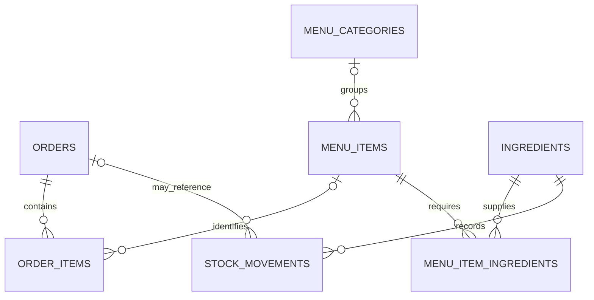

# Schema for the requested analytics sample data

The ready-to-run data script is [`local_analytics_sample_year.sql`](../supabase/snippets/local_analytics_sample_year.sql). Copy the **entire SQL file** into the local Supabase SQL Editor. This document describes its existing database tables and relationships; it is not a separate database installation script.

The sample period is **October 31, 2025–October 30, 2026**, inclusive, in Asia/Manila time. The script creates 6,009 completed, paid demo orders, with 1–3 line items per order and varied quantities, using existing menu prices and variants.

## Relationships



`order_inventory_deductions.order_id` also identifies an order by `orders.id::text`. This is an existing logical association stored as text, not a declared foreign key. Sample orders receive a marker before their status becomes Completed, so importing historical sales does not deduct today's stock.

## Tables written by the sample script

### `public.orders`

| Column | Database type | Sample usage |
| --- | --- | --- |
| `id` | `bigint`, identity, primary key | Database-generated order ID |
| `order_number` | `text`, unique, required | `DAYO-DEMO-Y1-20251031-001` |
| `customer_name` | `text`, required | `Demo Customer 001` and similar labels |
| `source` | `text`, required | `QR Order` or `Manual POS` |
| `payment_status` | `text`, required | `Paid` |
| `payment_method` | `public.payment_method` | `Cash` or `GCash` |
| `payment_reference_number` | `text`, nullable | A `DEMO-` reference for GCash orders |
| `order_type` | `public.order_type`, required | `Dine In` or `Take Out` |
| `status` | `public.order_status`, required | Inserted as Pending, then completed within the transaction |
| `notes` | `text`, required | `[DAYO DEMO YEAR V1] Synthetic analytics data; not a real sale.` |
| `created_by` | `uuid`, nullable | Left unset; no staff account is invented |
| `created_at`, `updated_at` | `timestamptz`, required | Historical order time; existing update triggers may stamp update time |

The current order enums are `Pending`, `Preparing`, `Ready`, `Completed`, `Cancelled`; `Dine In`, `Take Out`; and `Cash`, `GCash`.

### `public.order_items`

| Column | Database type | Sample usage |
| --- | --- | --- |
| `id` | `bigint`, identity, primary key | Database-generated line ID |
| `order_id` | `bigint`, required, foreign key | References `orders.id` |
| `menu_item_id` | `bigint`, nullable, foreign key | References an existing `menu_items.id` |
| `item_name` | `text`, required | Menu name captured for sales history |
| `selected_variant_key` | `text`, nullable | Existing variant key, when present |
| `variant_label` | `text`, nullable | Existing variant label, when present |
| `unit_price` | `numeric(10,2)`, required, >= 0 | Existing menu/variant price |
| `quantity` | `integer`, required, > 0 | Between 1 and 3 per generated line |
| `subtotal` | `numeric(12,2)`, generated | `unit_price * quantity`; never inserted manually |
| `recommendation_source` | `text`, nullable | Left unset; no AI recommendations are invented |

### `public.ingredients`

| Column | Database type | Sample usage |
| --- | --- | --- |
| `id` | `bigint`, identity, primary key | Existing ingredient ID |
| `name` | `text`, unique, required | Existing name |
| `category` | `text`, required | Existing category |
| `current_stock` | `numeric(12,3)`, required, >= 0 | Only eligible zero quantities are refilled |
| `reorder_level` | `numeric(12,3)`, required, >= 0 | Read to size the refill; not directly changed by the script |
| `unit` | `text`, required | Existing stored unit; no conversion is performed |
| `unit_cost` | `numeric(18,7)` when newly added, nullable, >= 0 | Approved illustrative cost per stored unit; existing precision is retained if the column already exists |
| `expires_on` | `date`, nullable | Existing expiry; expired ingredients are skipped |
| `created_at`, `updated_at` | `timestamptz`, required | Existing timestamp behavior |

If `archived_at` exists from other migrations, archived ingredients are skipped as well. Adding the archive table alone does not add that column. Unknown units are skipped for explicit review.

The only schema extension in the sample-data script is already included in that file:

```sql
alter table public.ingredients
  add column if not exists unit_cost numeric(18,7)
  check (unit_cost >= 0);
```

Sample costs are 8 pesos per piece, 0.12 pesos per gram, 0.06 pesos per mL, 120 pesos per kg, and 60 pesos per L. Positive existing costs are kept. These are demonstration prices, not purchase-cost estimates.

### `public.stock_movements`

| Column | Database type | Sample usage |
| --- | --- | --- |
| `id` | `bigint`, identity, primary key | Database-generated movement ID |
| `ingredient_id` | `bigint`, required, foreign key | Ingredient that received a zero-stock refill |
| `adjustment` | `numeric(12,3)`, required, nonzero | Positive amount actually added |
| `reason` | `text`, required | `[DAYO DEMO YEAR V1] Sample refill of zero stock` |
| `order_id` | `bigint`, nullable, foreign key | Left unset for these refills |
| `created_by` | `uuid`, nullable | Left unset |
| `created_at` | `timestamptz`, required | Default timestamp of the sample refill |

The script creates one positive movement per actual refill. Historical order consumption is not generated.

### `public.order_inventory_deductions`

| Column | Database type | Sample usage |
| --- | --- | --- |
| `order_id` | `text`, primary key | New demo order's ID converted to text |
| `deducted_at` | `timestamptz`, required | Historical order timestamp |

## Existing lookup data

The script reads existing `menu_items`, `menu_item_variants`, `menu_item_variant_sets`, `menu_variant_options`, and `menu_item_ingredients`. Shared variant sets take priority over per-item variants. It uses menu category/subcategory IDs for demand weighting. The reporting code reads `menu_categories` for display names and category grouping. These lookup records are not created or changed by the seed.

## Chart mappings

| Requested display | Data and calculation |
| --- | --- |
| Revenue Monitoring | Sum of `order_items.subtotal` for Completed orders |
| Revenue Monitoring Chart | The same revenue grouped by Manila date and the selected period |
| Customer Map | Count of non-cancelled orders per Manila day; represents order activity |
| Sales Trend | Completed-order revenue grouped by hour/day/week/month and selected menu/category |
| Fast-moving / Slow-moving | Completed-order quantities per active menu item, compared within the item's category/subcategory using the app's existing formula |
| Zero stock quantities | Eligible `ingredients.current_stock = 0` plus a positive stock movement |
| Stock peso value | `ingredients.current_stock * ingredients.unit_cost` |

No separate revenue, customer-map, sales-trend, or movement tables are required. Derived views such as Total Orders and Top Menu also include the generated demo orders. Previous-period comparisons have demo data only when their date ranges fall within the seeded year.
